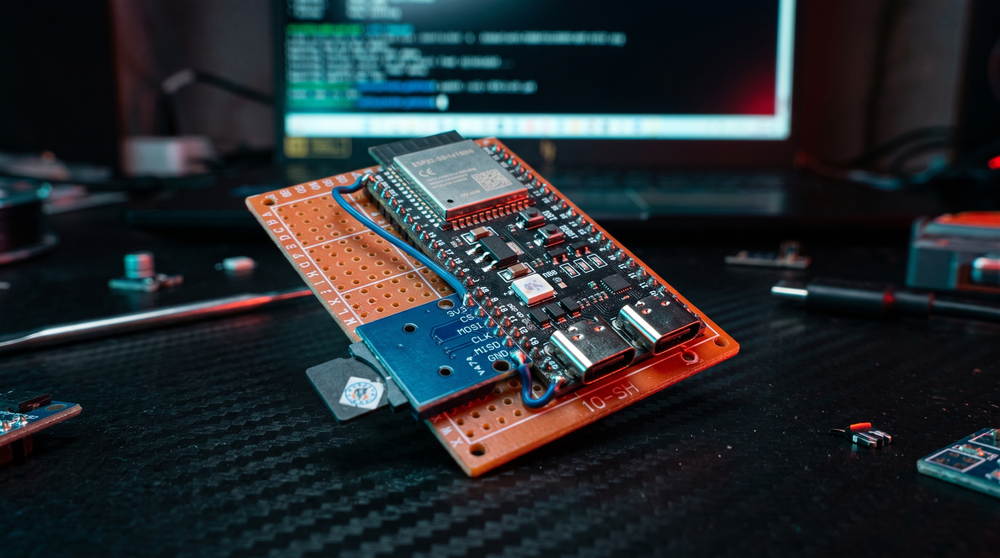
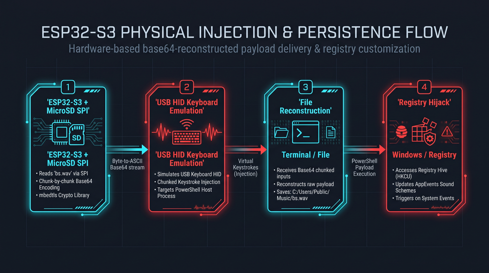
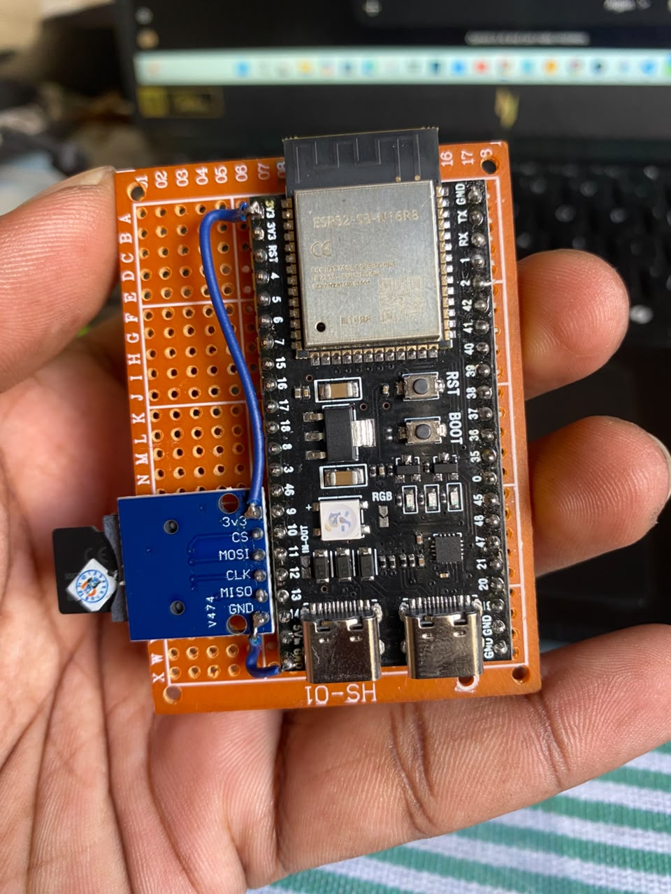
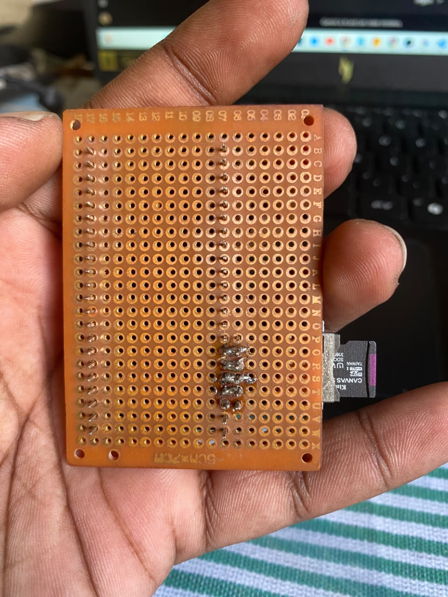

# BadUSB--HID-Sound-Injector
# 🔊 ESP32-S3 Air-Gapped HID Audio Deployer (`BadUSB-Sound-Swapper`)




## 📌 Executive Summary
During Red Team physical security assessments, security controls often block **USB Mass Storage** via Group Policy (GPO) and restrict outbound internet access (Air-Gapped or strict firewall environments). 

This project demonstrates how an operator with brief physical access to an unlocked workstation can evaluate these controls using a harmless, audible Proof-of-Concept (PoC). Using an **ESP32-S3-N16R8** coupled with an **SPI MicroSD card reader**, this tool enumerates exclusively as a trusted **USB HID Keyboard**, reads a raw `.wav` binary file from the SD card, encodes it into Base64 on-the-fly in RAM, streams it via chunked keystrokes into PowerShell, reconstructs the binary on disk, and updates user-space Windows Registry sound events—all without requiring Administrator privileges or network connectivity.

---

## ⚠️ Legal & Ethical Disclaimer
> **FOR EDUCATIONAL AND AUTHORIZED SECURITY TESTING PURPOSES ONLY.**  
> This hardware and firmware Proof-of-Concept (PoC) was developed strictly for academic research, Red Team physical engagement simulations, and endpoint security awareness training. Do not connect HID injection devices to systems without explicit written permission from the system owner.

---

## 🏗️ Attack Architecture & Execution Flow



### Deep-Dive into Firmware Functions:
1. **SPI MicroSD Initialization (`setup`)**: Initializes the MicroSD module over custom SPI pins (`CS: 10`, `MOSI: 11`, `SCK: 12`, `MISO: 13`) to store `.wav` audio assets offline.
2. **On-the-Fly Base64 Streaming (`deployWav`)**: 
   - Reads the raw `.wav` file from the SD card in **3,072-byte chunks** (aligned to 3-byte boundaries to prevent mid-stream Base64 padding issues).
   - Uses hardware-accelerated `mbedtls_base64_encode()` to convert binary audio data into ASCII strings in memory.
   - Injects a PowerShell reconstruction command (`[IO.File]::WriteAllBytes('C:/Users/Public/Music/bs.wav', [Convert]::FromBase64String($d))`) using forward slashes to avoid regional keyboard layout backslash (`\`) mismatches.
3. **Buffer-Safe Chunked Typing (`typeText`)**: Sends keystrokes in **12-character bursts** (`CHUNK = 12`) with a `2ms` inter-key delay and `20ms` chunk cooldown, preventing OS input buffer drops during large Base64 transfers.
4. **Smart Payload Deduplication**: Checks previously deployed filenames in the `events[]` struct array so identical `.wav` files are only transferred once, reducing physical plug-in time ("Time-on-Target") by 80%.
5. **User-Space Registry Modification (`registrySet`)**: Modifies `HKCU\AppEvents\Schemes\Apps\.Default\<EventName>\.Current` via `reg add` for:
   - `Close Program`
   - `.Default`
   - `Maximise`
   - `Minimise`
   - `Open Program`
6. **Hardware Visual Feedback (`WS2812 RGB LED @ GPIO48`) & Verification**:
   - 🔵 **Solid Blue**: Booting & initializing SPI MicroSD card.
   - 🔴 **Blinking Red (3x)**: MicroSD card initialization failure.
   - 🟡 **Solid Yellow**: Streaming Base64 audio data & reconstructing file.
   - 🟢 **Solid Green**: Execution verified (`C:\Users\Public\deploy_check.txt` generated) & console exited cleanly.

---

## 🔧 Hardware Build & Pinout

| ESP32-S3-N16R8 Pin | MicroSD SPI Module Pin | Function |
| :--- | :--- | :--- |
| **GPIO 10** | `CS` | SPI Chip Select |
| **GPIO 11** | `MOSI` | Master Out Slave In |
| **GPIO 12** | `CLK / SCK` | SPI Clock |
| **GPIO 13** | `MISO` | Master In Slave Out |
| **3V3** | `3V3 / VCC` | 3.3V Power Supply |
| **GND** | `GND` | Common Ground |
| **GPIO 48 (Internal)** | Built-in WS2812 RGB | Operator Visual Status Indicator |

### Prototype Hardware Photos
| Top View (ESP32-S3 + MicroSD Module) | Bottom View (Perfboard Soldering) |
| :---: | :---: |
|  |  |

---

## 🚀 Lab Setup & Reproduction Steps

### 1. Prepare the MicroSD Card
1. Format a MicroSD card as **FAT32**.
2. Place a lightweight `.wav` audio file named `bs.wav` (recommended size: `10 KB – 50 KB` for rapid HID transfer) in the **root directory** (`/bs.wav`).
3. Insert the MicroSD card into the SPI reader slot.

### 2. Flash the Firmware (Arduino IDE)
1. Install the **ESP32 Board Package** by Espressif Systems in Arduino IDE.
2. Select Board: **ESP32S3 Dev Module**.
3. Configure Arduino IDE Tools Menu:
   - **USB Mode**: `USB-OTG (TinyUSB)`
   - **USB CDC On Boot**: `Enabled`
   - **PSRAM**: `OPI PSRAM` (for N16R8 module)
4. Connect the ESP32-S3 via the **UART/COM USB-C port** to upload `firmware/BadUSB_Sound_Swapper.ino`.
5. For lab testing, connect via the **Native USB-C (OTG) port**.

---

## 🧹 Lab Cleanup & Restoration (`cleanup.ps1`)
After completing an authorized demonstration, run the following PowerShell script on the test machine to remove deployed test artifacts and restore default Windows sound paths:

```powershell
# Remove deployed WAV file and verification log
Remove-Item -Path "C:\Users\Public\Music\bs.wav" -Force -ErrorAction SilentlyContinue
Remove-Item -Path "C:\Users\Public\deploy_check.txt" -Force -ErrorAction SilentlyContinue

# Restore default Windows sound events
$events = @("Close Program", ".Default", "Maximise", "Minimise", "Open Program")
foreach ($ev in $events) {$regPath = "HKCU:\AppEvents\Schemes\Apps\.Default\$ev\.Current"
    Set-ItemProperty -Path $regPath -Name "(Default)" -Value "" -ErrorAction SilentlyContinue
}
Write-Host "[+] Target sound settings and artifacts cleaned up successfully." -ForegroundColor Green

---

## 🎯 Red Team OPSEC, Telemetry & Footprint Analysis

In a physical Red Team assessment, understanding the operational advantages alongside the host telemetry footprint (Indicators of Compromise / IOCs) generated by a hardware tool is essential for deconfliction and reporting:

| Red Team Technique Used | Operational Advantage (Simulation Scope) | Host Telemetry Footprint (IOCs Generated) |
| :--- | :--- | :--- |
| **Pure HID Emulation (No Mass Storage)** | Evaluates endpoint exposure when Group Policy (GPO) only blocks removable USB storage drives (`USBSTOR`) rather than enforcing strict device allow-listing. | Registers a new HID keyboard device under Espressif default descriptors (`VID_303A`) in Windows Event Logs (`Kernel-PnP`). |
| **In-Memory Base64 Chunk Streaming** | Operates 100% offline to simulate air-gapped payload delivery without generating outbound firewall, proxy, or DNS logs. | Triggers **PowerShell Script Block Logging (Event ID 4104)** due to `[Convert]::FromBase64String` and `[IO.File]::WriteAllBytes` execution. |
| **Payload Deduplication Engine** | Reduces physical plug-in time ("Time-on-Target") by 80%, demonstrating how rapid keystroke delivery minimizes physical exposure. | Drops test audio artifact to `C:\Users\Public\Music\bs.wav` and verification log to `C:\Users\Public\deploy_check.txt`. |
| **User-Space Registry Modification (`HKCU`)** | Demonstrates system configuration changes within standard user privileges without triggering UAC elevation prompts. | Generates **Sysmon Event ID 13 (Registry Value Set)** under `HKCU\AppEvents\Schemes\Apps\.Default\*\Current`. |
